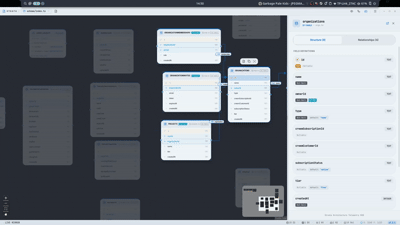

<div align="center">

# Strata

**Visual Architecture & ERD Studio for Drizzle ORM and the Cloudflare Workers Ecosystem**

[](LICENSE)
[](https://svelte.dev)
[](https://v2.tauri.app)
[](https://orm.drizzle.team)
[](tests/)
<a href="https://0rwx.com/" title="0rwx AI Disclosure: AI:W (Assisted / Human Reviewed)"></a>

_Single Source of Truth • AST-Driven • Local-First • Zero Git Merge Conflicts • Zero Lock-In_

<br />



</div>

---

## Why Strata?

Database diagram tools usually force you to choose between proprietary JSON sidecars, cloud databases, or stale exports. **Strata uses your TypeScript schema codebase as the single source of truth**, running side-by-side with your primary editor (**VS Code, Cursor, WebStorm**).

- **Git-Clean Diff Guarantee (`@strata-layout`)**: In modular projects (`schema/index.ts`), canvas layout coordinates live **exclusively** in a consolidated comment in the root barrel file. Moving cards on the canvas touches **0 domain files** (`users.ts`, `posts.ts`), eliminating visual Git merge conflicts.
- **External IDE Pairing**: Native file watchers detect disk changes in milliseconds. Edit code in your editor, and the canvas updates instantly without layout jitter.
- **Cloudflare Topology on One Canvas**: View and design Cloudflare D1 SQL tables alongside KV Namespaces, Durable Objects (with live RPC method extraction), R2 Buckets, and Cloud Identity boundaries.
- **Zero Lock-In**: No proprietary runtime dependencies. Deleting the metadata comments leaves 100% standard, clean Drizzle TypeScript.

---

## Core Capabilities

### 1. Drizzle Dual-Archetype Support
- **Modular Barrels (`schema/index.ts`) [Recommended]**: Automatically discovers domain files, cross-module imports (`import { users } from "./users"`), and standalone `relations.ts` definitions.
- **Single-File Monoliths (`schema.ts`)**: Supports inline `@strata` JSDoc comments directly above table declarations.

### 2. Cloudflare Edge Architecture
- **Cloudflare D1**: Visual schema designer for tables, columns, primary keys, and foreign keys.
- **KV Namespaces**: Key-value schemas with explicit value types, TTL guards (60s minimum), and synthetic relations.
- **Durable Objects (DO)**: Class targets, embedded storage, and RPC public method discovery via `@strata-layout { "path": ... }`.
- **R2 Storage Buckets**: Bucket bindings, CORS rules, public flags, and folder structure definitions (`"folders": { "builds": "application/zip" }`).

### 3. Modern Identity & Auth Topologies
- **D1-Resident Auth (Better Auth / Lucia)**: Detects core auth clusters (`user`, `session`, `account`, `verification`) with `Better Auth` badges.
- **Cloud IdPs (Clerk & WorkOS)**: Detects external provider references (`clerkUserId`, `workosOrgId`) and renders visual Identity Boundary Nodes with 1-click webhook mirror table scaffolding.

### 4. Interactive Keyboard & Canvas Controls
| Shortcut | Action |
| :--- | :--- |
| `2× Click` on Node | **Zoom to Node** (centers viewport and opens Inspector) / Toggle Zoom |
| `2× Click` Canvas / `0` | **Fit View** (zooms out to display the entire diagram) |
| `Enter` | **Inspect Architecture** (opens Inspector for the selected entity) |
| `E` | **Open in Editor** (jumps directly to line in VS Code / Cursor / Zed) |
| `C` | **Copy Snippet** (copies Drizzle definition or DO/KV interface to clipboard) |
| `F` | **Isolate Subgraph** (locks 1-hop upstream and downstream dependencies) |
| `/` or `Ctrl+F` | **Search Palette** (instant fuzzy search across tables, bindings, and fields) |

---

## The `@strata-layout` Manifest

In modular projects (`schema/index.ts`), visual coordinates and non-SQL Cloudflare bindings are declared in the root barrel manifest. **Domain files (`users.ts`, `posts.ts`) remain 100% pure Drizzle code:**

```typescript
// src/schema/index.ts
/**
 * @strata-layout {
 *   "users": { "x": 100, "y": 150 },
 *   "posts": { "x": 520, "y": 150 },
 *   "__clerk_identity__": { "x": -260, "y": 150 },
 *   "SESSIONS_KV": { "x": 100, "y": 480, "target": "kv", "relations": [{ "to": "users" }] },
 *   "UserDO": {
 *     "x": 520,
 *     "y": 480,
 *     "target": "do",
 *     "path": "../do/UserDO.ts",
 *     "class": "UserDO",
 *     "methods": ["getProfile", "updateSession"]
 *   }
 * }
 */
export * from "./users";
export * from "./posts";
```

---

## Tech Stack

| Component | Technology |
| :--- | :--- |
| **UI Framework** | [SvelteKit](https://kit.svelte.dev) (Svelte 5 Runes) |
| **Desktop Shell** | [Tauri 2.0](https://v2.tauri.app) (Rust) |
| **Diagram Canvas** | [@xyflow/svelte](https://svelteflow.dev) (Svelte Flow) |
| **Styling** | [Tailwind CSS v4](https://tailwindcss.com) + [DaisyUI v5](https://daisyui.com) |
| **ORM Dialect** | [Drizzle ORM](https://orm.drizzle.team) (SQLite / Cloudflare D1) |
| **AST Parser** | [ts-morph](https://ts-morph.com) |

---

## Quick Start

### Prerequisites
- [Node.js](https://nodejs.org) (v18+)
- [Rust Toolchain](https://www.rust-lang.org)

```bash
# 1. Clone the repository
git clone https://github.com/cntrvsy/strata.git
cd strata

# 2. Install dependencies
npm install

# 3. Launch desktop app in development
npm run tauri dev
```

> **Linux AppImage Note**: When running the `.AppImage` binary directly, make sure to grant execute permissions (`chmod +x Strata_*.AppImage`). Use [Gear Lever](https://flathub.org/apps/it.miurus.gearlever) to easily integrate the AppImage into your desktop application menu and dock.

---

## Testing & Quality Assurance

Strata maintains a strict suite of unit, AST mutation, and type diagnostic tests:

```bash
# Svelte 5 rune & TypeScript diagnostic checks
npm run check

# Vitest test suite (230 tests across 17 files)
npm test

# Playwright E2E UI tests
npm run test:e2e
```

---

## AI Usage Disclosure (0rwx Framework)

<p align="center">
  <a href="https://0rwx.com/">
    
  </a>
  <br />
  <strong>Level AI:W — Assisted / Human Reviewed</strong>
  <br />
  <em>Standardized AI transparency notation (<a href="https://0rwx.com/">0rwx.com</a>)</em>
</p>

Strata is developed following the **[0rwx framework](https://0rwx.com/)** at level **AI:W (Assisted / Human Reviewed)**:

- **AI Pair Programming**: Architectural prototyping, Svelte 5 rune migrations, ts-morph AST transform scaffolds, and starter blueprint synthesis were conducted in pair programming sessions with **Google Antigravity** and **Gemini** models.
- **Human Engineering & Verification**: All AST mutators, Tauri 2.0 Rust coordinators, zero-merge-conflict layout mechanics, and test suites (230 Vitest tests) are designed, reviewed, and verified by human engineering.

---

## Credits

Crafted by **[FR Studios](https://frstudios.co.ke)**.

---

## License

Distributed under the MIT License. See [`LICENSE`](LICENSE) for details.
